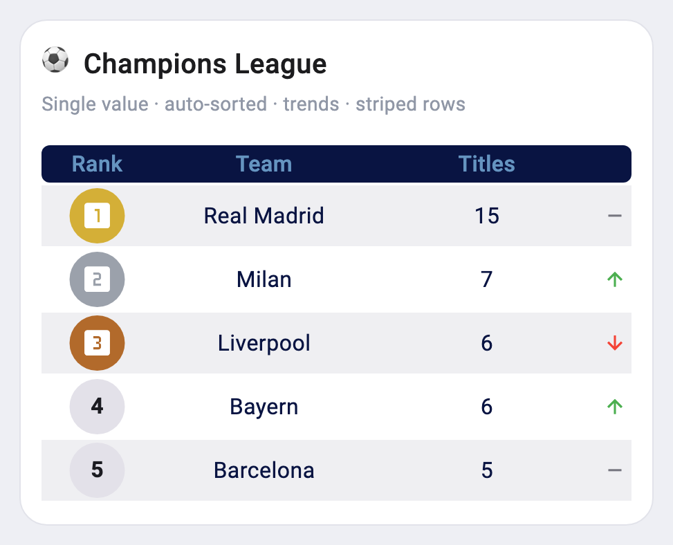
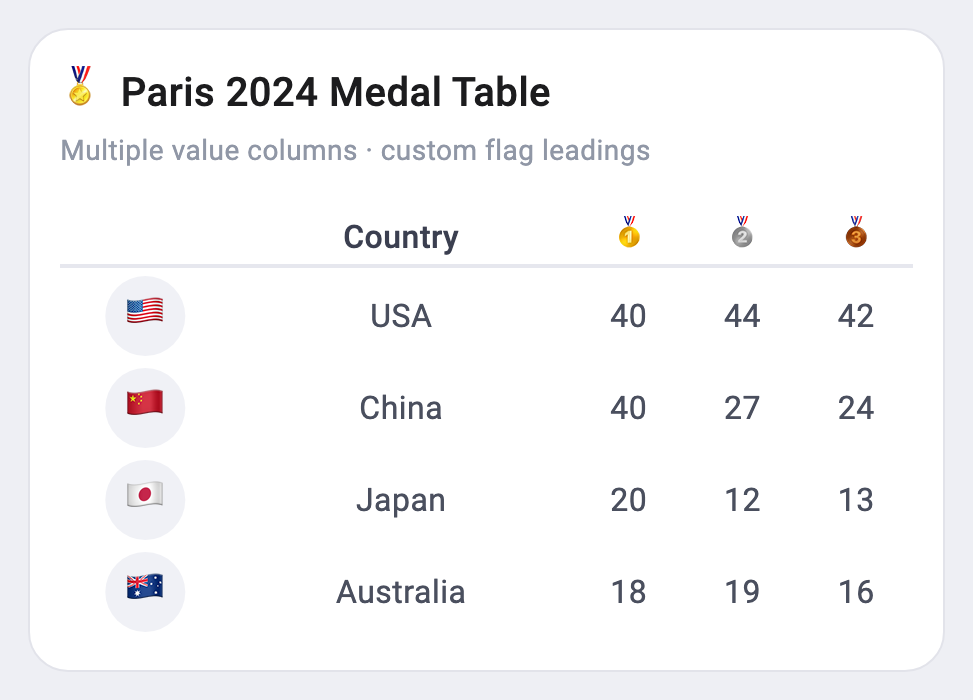
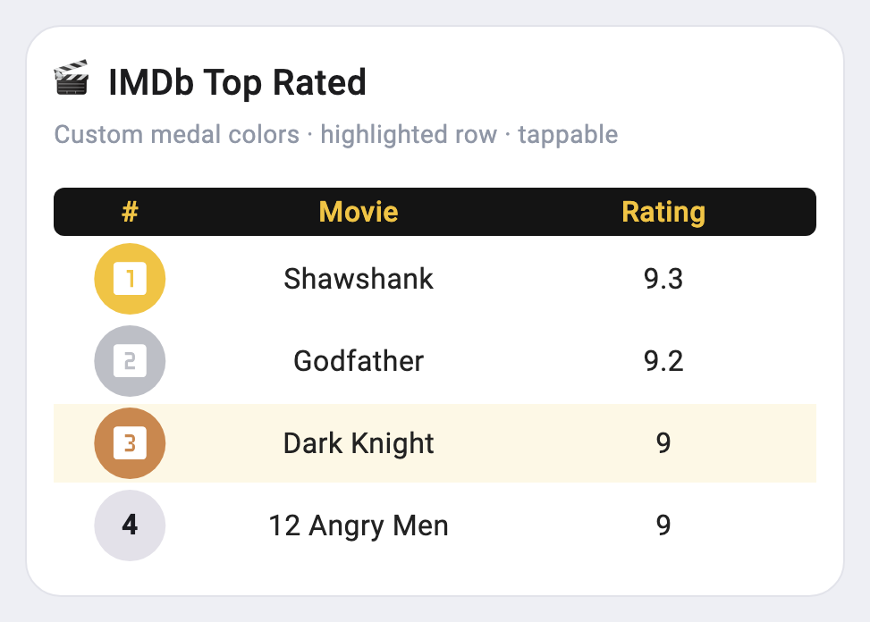
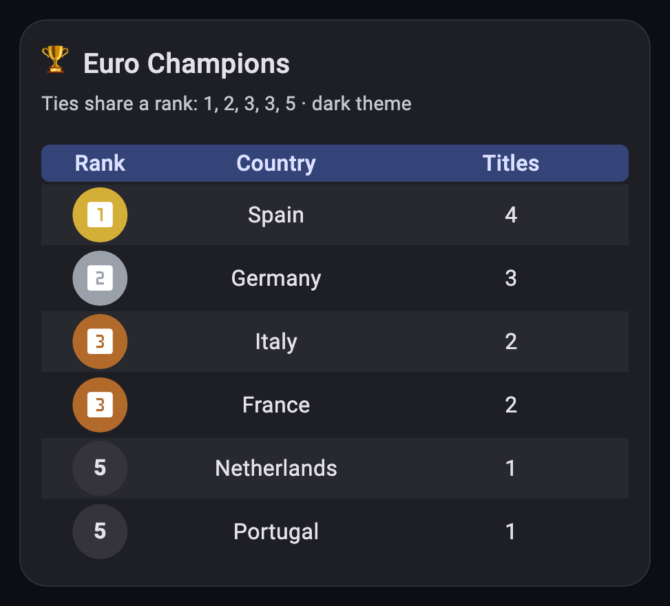

# Medal Table

A customizable ranking ("medal") table for Flutter. Give it a list of items and
it ranks them — gold, silver and bronze medals for the top three, numbered
badges for the rest — with optional sorting, highlighting, trends and more.

## Samples






## Usage

```dart
import 'package:medal_table/medal_table.dart';

MedalTable(
  leadingTitle: 'Rank',
  labelTitle: 'Team',
  valueTitle: 'UCL Titles',
  sortByValue: true, // rank rows by value automatically
  headerDecoration: BoxDecoration(
    color: const Color(0xff091442),
    borderRadius: BorderRadius.circular(6),
  ),
  headerTextStyle: const TextStyle(fontSize: 18, color: Color(0xff6594C0)),
  itemTextStyle: const TextStyle(fontSize: 16, color: Color(0xff091442)),
  items: const [
    TableItemModel(title: 'Real Madrid', value: 15),
    TableItemModel(title: 'Milan', value: 7),
    TableItemModel(title: 'Liverpool', value: 6),
    TableItemModel(title: 'Bayern', value: 6), // 4th place → numbered badge
  ],
);
```

## Features

| Feature | How |
| --- | --- |
| Any number of rows | `items: List<TableItemModel>` |
| Auto sorting | `sortByValue: true`, `descending: true` |
| Shared ranks for ties (1, 2, 3, 3, 5) | `sharedRanks: true` |
| Multiple value columns | `valueTitles: [...]` + `TableItemModel.values` |
| Highlight a row | `TableItemModel(highlightColor: ...)` |
| Alternating row colors | `oddRowColor` / `evenRowColor` |
| Trend arrows | `showTrend: true` + `TableItemModel.trend` |
| Trend arrow colors | `trendUpColor` / `trendDownColor` / `trendSameColor` |
| Custom medal colors | `medalColors: [...]` |
| Column widths | `leadingFlex` / `labelFlex` / `valueFlex` |
| Scroll with fixed header | `maxHeight: ...` |
| Row tap (with ripple) | `TableItemModel(onItemPressed: ...)` |
| Screen-reader label | `semanticsLabelBuilder: (item, rank) => ...` |

Numbered badges and the "same" trend marker follow your app's `ColorScheme`,
so the table works in both light and dark themes.

### Sorting

With `sortByValue: true`, rows are compared by `value` first and then by
`values`, column by column. Rows that are still equal keep the order you gave
them, and rows without a value always go last. Set `sharedRanks: true` to give
tied rows the same rank and medal.

### Multiple value columns (e.g. an Olympic medal table)

Sorting by `values` ranks countries by gold, then silver, then bronze — no
separate `value` needed:

```dart
MedalTable(
  leadingTitle: 'Rank',
  labelTitle: 'Country',
  valueTitles: const ['Gold', 'Silver', 'Bronze'],
  sortByValue: true,
  sharedRanks: true,
  items: const [
    TableItemModel(title: 'USA', values: [40, 44, 42]),
    TableItemModel(title: 'China', values: [40, 27, 24]),
    TableItemModel(title: 'Japan', values: [20, 12, 13]),
  ],
);
```

Every item's `values` must have the same length as `valueTitles`; a mismatch
is reported in debug mode.

### Long tables

Without `maxHeight`, the table is as tall as all of its rows. In a space of
limited height (e.g. a `Scaffold` body), either set `maxHeight` — rows then
scroll under a fixed header and are built lazily — or wrap the table in a
`SingleChildScrollView`.

### Localizing the screen-reader label

Each row is announced once, e.g. "Rank 1, Real Madrid, 15". To change or
translate it:

```dart
MedalTable(
  // ...
  semanticsLabelBuilder: (item, rank) => '$rank. sıra, ${item.title}',
);
```

### Updating items

`TableItemModel` is immutable. Use `copyWith` to change fields, and the
`clear…` flags to remove optional ones:

```dart
final updated = item.copyWith(value: 16, clearHighlightColor: true);
```

## Installation
[Installing](https://pub.dev/packages/medal_table/install)

## Migrating from 2.x

`firstItem` / `secondItem` / `thirdItem` are replaced by a single `items` list,
and the API is now exported from one file:

```dart
// Before (2.x)
import 'package:medal_table/view/medal_table.dart';
MedalTable(
  firstItem: TableItemModel(title: 'Real Madrid', value: 15),
  secondItem: TableItemModel(title: 'Milan', value: 7),
  thirdItem: TableItemModel(title: 'Liverpool', value: 6),
  // ...
);

// After (3.0)
import 'package:medal_table/medal_table.dart';
MedalTable(
  items: const [
    TableItemModel(title: 'Real Madrid', value: 15),
    TableItemModel(title: 'Milan', value: 7),
    TableItemModel(title: 'Liverpool', value: 6),
  ],
  // ...
);
```
